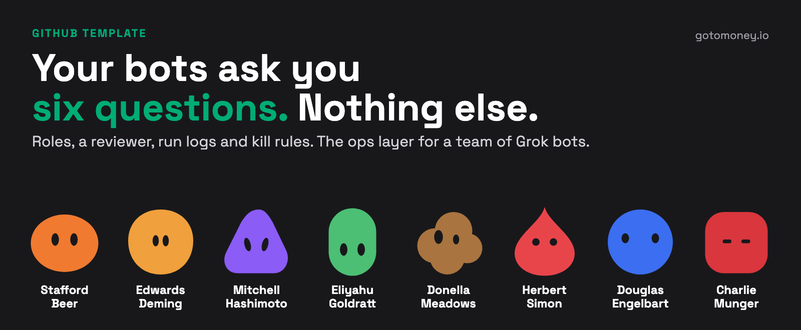
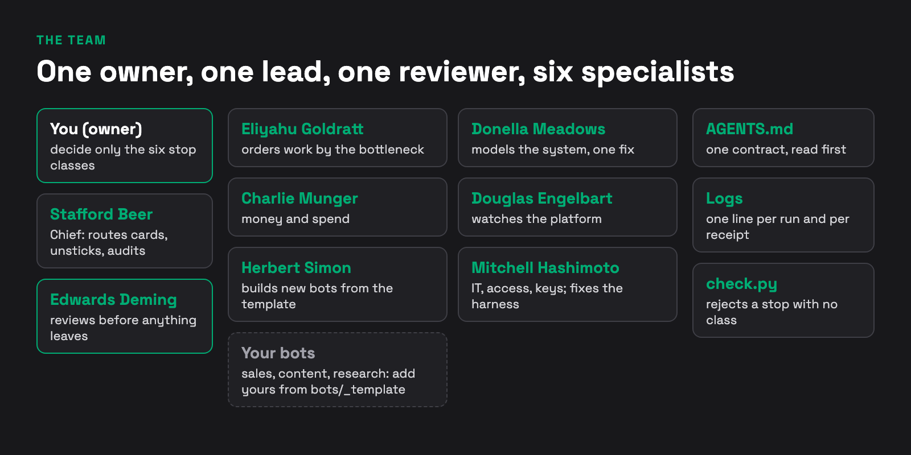
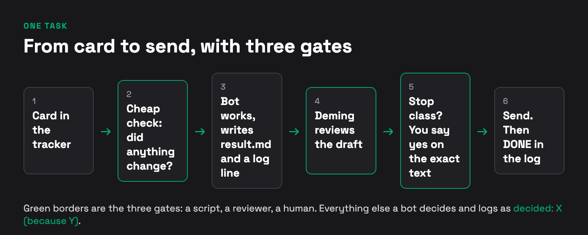
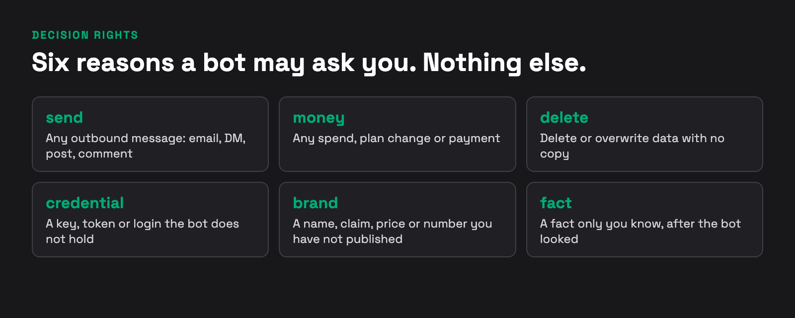

# Grok bot ops team

A template for running a team of Grok bots (or any chat agents) with an **ops layer**: roles, six stop classes, a reviewer, run logs, routing and kill rules. Click **Use this template** to start your own.

The ops layer is the part that makes the other bots safe to leave alone. It is the part most setups skip.

## What is in the box
| Path | What it is |
|---|---|
| `AGENTS.md` | The one contract every bot reads: invariants, read ladder, six stop classes, log format |
| `ops/bots.md` | The ops roster: 8 bots, one job each |
| `ops/principles.md` | The idea behind each rule, and what breaks without it |
| `ops/usage-and-cost.md` | Run log, cheap check, weekly prune: how not to burn the allowance |
| `ops/descriptions.md`, `ops/privacy.md`, `ops/contracts.md` | One home for rules, memory and restarts, privacy gate, format contracts |
| `ops/routing.md` | What bots do, what they hand to a coding agent, how a stuck card escalates |
| `bots/<slug>/block.md` | One block per bot: job, routine, kill rule, paste-ready Description |
| `bots/_template/block.md` | Copy this for a new bot |
| `skills/` | Skill format and one example |
| `scripts/check.py` | A gate for the log format (`--self-test` included) |
| `CREDITS.md` | Who inspired what |
| `scripts/precheck.py`, `templates/` | Wake-a-bot-only-if-changed script, log and run line examples |
| `hints/HINTS.md` | Hints and tips from X, with credits |

## The six headline rules (the full list of 12 is in `ops/principles.md`)
1. **One bot, one job** (principle 1). If the job sentence has "and", split it.
2. **Six stop classes** (principle 2). A bot asks the owner only for `send`, `money`, `delete`, `credential`, `brand` or `fact`. For anything else it decides, then logs `decided: X (because Y)`.
3. **A stop names its class** (principle 3). The gate rejects a `BLOCKED` or `HUMAN_HOLD` log line with no `[ask: class]`.
4. **A reviewer sits before every send** (principle 4). The Deming bot checks drafts and turns the owner's repeated answers into rules. Watch the trend of stops with no class.
5. **Deterministic first** (principle 5). A step a rule can decide goes to a script (0 tokens). The bot keeps only judgement.
6. **Every bot has a kill rule** (principle 10). It names the evidence that stops the bot. A bot with no accepted work for 4 weeks goes to the Retire list.

## Names
The ops bots carry the name of an author. The name is a label for one idea, so a log line such as `Deming: PASS` tells you the rule before you open a file.

| Bot | Idea borrowed |
|---|---|
| Edwards Deming | Improve the process, not the person. This bot is a deliberate inspection gate, a trade-off against Deming's own view that quality comes from the process; its lessons register is what feeds the process back |
| Eliyahu Goldratt | Order work by the constraint |
| Donella Meadows | Find the leverage point, not the symptom |
| Charlie Munger | Invert, check the incentives, do the money math |
| Douglas Engelbart | Improve the way the team improves |
| Herbert Simon | Bounded rationality: build small and good enough (satisficing); one job per bot is closer to his near-decomposability |
| Stafford Beer (Chief) | The purpose of a system is what it does: audit bots by what they do |
| Mitchell Hashimoto | Fix the harness, not the prompt |

Ideas are "as I read them". Caveats: none of these people reviewed or endorsed this repo. One idea per name is a simplification, and I may read some authors wrong. The name does not do the work. The rule has to live in the bot's Description, its log and the check script. You can rename every bot; the template works the same.

## Words used here
- **Description**: the bot's instructions field in the Grok Bot app (its role rules, read every turn).
- **Routine**: a scheduled or event-triggered run of a bot.
- **Card / task**: one unit of work in your tracker, with an id.
- **Receipt**: the status word in a log line (`CLAIMED`, `DONE`, `BLOCKED`, `HUMAN_HOLD`, `FAILED`, `FOLLOW_UP`).
- **Stop class**: one of six reasons a bot may ask you instead of deciding.
- **Retire list**: bots the audit proposes to switch off.

## Start (budget about an hour, not 15 minutes)
1. Click **Use this template**. Clone your copy.
2. Replace the placeholders. `<OWNER>` = your name or handle. `<TRACKER>` = where your tasks live (Notion, Linear, Trello) or a `TASKS.md` file. Find them with `grep -rn "<OWNER>\|<TRACKER>" .` (they are in `AGENTS.md` and `bots/*/block.md`).
3. Push your copy to a **public** repo (or give the bot a read connector). A Grok bot runs in the vendor's cloud and cannot see files on your laptop. The simplest route: the bot reads the public repo URL; the alternative is to paste `AGENTS.md` and its block into the bot.
4. In the Grok Bot app create **Chief** first: paste its Description line from `bots/chief/block.md` into the Description field. Add **Deming** next. Add the rest only when a real job needs them.
5. Run Chief once. A first log line looks like `templates/log-line.jsonl`. Then run `python3 scripts/check.py --self-test` and `python3 scripts/check.py`.
6. When routines start burning allowance, read `ops/usage-and-cost.md` and use `scripts/precheck.py`.

## What this does not do
- It does not include any sales bots, contacts, prompts for outreach, or client data.
- It makes no claim that it will make a bot team go viral, earn money or save a fixed number of hours. Measure your own.
- It does not replace a human who reads what goes out.

## Hints and tips
See [`hints/HINTS.md`](hints/HINTS.md). They come from public X posts (scan of 2026-10-26) and are credited by handle. Check each against current vendor docs before you rely on it.

## License
MIT. See `LICENSE`.
